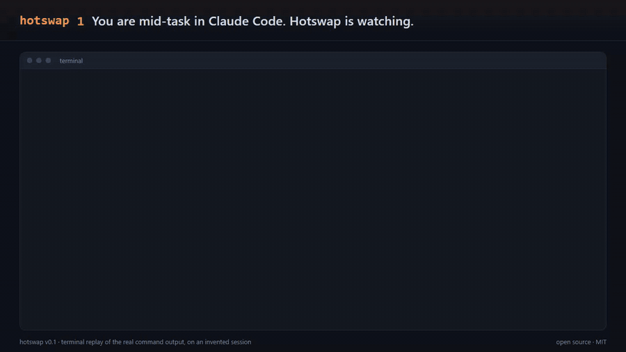

# Hotswap

**Hit your AI's limit in the middle of a critical task? Switch to another AI without losing the thread.**

Hotswap turns a Claude Code or Antigravity session into a *capsule*: one Markdown file with the goal, the open tasks, the files and commands, the last turns word for word, and every code block exactly as written. Hand it to any AI and it can carry on from where you stopped.

- **No AI model, no server, no account.** Everything is plain code running on your computer. Nothing is uploaded.
- **Limit-aware.** For Claude Code it notices the moment the plan limit is hit and has a capsule ready.
- **Checkable.** Every capsule ends with a fidelity report and a hash, and `hotswap check` tells you if the file was changed.
- **Secrets are removed first.** If that step fails, nothing is written.



*Terminal replay of the real command output on an invented session (no real chat). The full 47-second video is `docs/media/hotswap-demo.mp4`; `launch/demo/` regenerates it.*

This is the local half (v0.1). The browser extension for web chats (ChatGPT, Claude, Gemini) is planned next; see [PLAN.md](PLAN.md).

## Quick start

Needs Node 20 or newer.

```
npm install
npm run build
node dist/cli.js doctor          # what Hotswap can see on this machine
```

(`npm link` makes the command `hotswap` available everywhere.)

```
hotswap list                                   # recent sessions, Claude Code and Antigravity
hotswap to claude                              # newest session -> HANDOFF.md in its folder, and the command to start Claude
hotswap to web                                 # same, for pasting into ChatGPT / Gemini / Claude.ai
hotswap capture --from antigravity --preset full --out my.hotswap.md
hotswap watch                                  # Claude Code limit watcher: capsule appears when the limit is hit
hotswap watch --once                           # is the newest session stuck on a limit right now?
hotswap check my.hotswap.md                    # exactly as Hotswap wrote it?
```

Choose a session with `--id` (start of the id), `--project DIR`, or `--from claude|antigravity`. Presets decide how many recent turns travel word for word: `minimal` (3), `standard` (10, default), `verbose` (20), `full` (all).

`HANDOFF.md` can contain text from your project. Hotswap redacts keys and tokens, but read it before you share or commit it.

## What is in a capsule

| Part | Content |
|---|---|
| State card | Goal (first request), latest request, working folder and git branch, open tasks, files changed, last commands with ok/failed, last error, and why you are switching (only if a limit notice is the last thing in the session) |
| Recent conversation | The last N turns, quoted with `> ` so headings or code inside them cannot be mistaken for the capsule's own structure. Remove the `> ` to get the exact text |
| Code vault | The newest version of each code block (same language and first line), exact, with its sha256 |
| Tool notes | Antigravity's own `task.md`, `implementation_plan.md`, `walkthrough.md` |
| Fidelity report | Tier, turns read and included, code blocks found and kept, secrets removed (counts only), and every known loss |

**Tiers, stated honestly:** *verbatim* (preset `full`, nothing cut), *hybrid* (state card, recent turns and code exact; older turns covered by the state card only), *partial* (the source tool itself keeps only part of the conversation). Antigravity is always partial. Hidden reasoning is never exported.

## How it reads your tools (verified on a real machine)

| Tool | Reads | Notes |
|---|---|---|
| **Claude Code** | `~/.claude/projects/<project>/<session>.jsonl` | Full turns, tool calls and results, files touched, to-do list, working folder, git branch, title. Sub-agent files are left out. |
| **Antigravity** | `~/.gemini/antigravity/brain/<id>/.system_generated/logs/overview.txt` (JSON Lines) and the three notes files | Antigravity itself cuts each message at about 1,000 characters in this log and marks some steps as cleared, so capsules say *partial*. It **never opens** `conversations/*.pb` (not readable outside the app) or `state.vscdb` (it holds sign-in data). |
| Codex CLI *(experimental)* | `~/.codex/sessions/**/rollout-*.jsonl` | Written from the open-source cli-continues parser's description of the format. **No Codex session exists on the machine this was built on, so it is only tested on invented sessions.** Capsules from it say so. |
| Gemini CLI *(experimental)* | `~/.gemini/tmp/<project>/chats/*.json[l]` | Same: format from cli-continues, tested on invented sessions only. Different from Antigravity, which also lives under `~/.gemini`. |

Override the folders with `HOTSWAP_CLAUDE_DIR`, `HOTSWAP_ANTIGRAVITY_DIR`, `HOTSWAP_CODEX_DIR` and `HOTSWAP_GEMINI_DIR`. Use `--from codex` or `--from gemini-cli` to pick those tools. If you use Codex or Gemini CLI, `hotswap doctor` tells you whether sessions were found; please open an issue if a capsule looks wrong. Cursor is not supported: its chats live in an app database that also holds sign-in data, and Hotswap does not open those.

## The limit watcher

When Claude Code hits a plan limit it writes a line to the session file with `isApiErrorMessage: true`, `error: "rate_limit"`, HTTP 429, and the text `You've hit your session limit · resets 11:40am (Asia/Karachi)`. Other API errors (overloaded, auth, network) use other values and are ignored. `hotswap watch` reads only what is appended after it started, builds the capsule when that line appears, writes `HANDOFF.md`, and prints the reset time and the command to start the next AI. It never sends anything on its own.

## Measured

- 28 tests (`npm test`, Node 22.18 or newer runs the TypeScript directly; `npm run build` produces JavaScript for Node 20+). They use small invented sessions in the real file shapes, never real conversations.
- On the author's machine, `hotswap capture` read a 238 MB Claude Code session of 1,102 turns and wrote a 41 KB capsule in 2.9 seconds. The redactor removed 5 items from that capture (1 token-shaped string and 4 secret-looking environment lines); in the tests, planted fake secrets of eight kinds are all caught.
- The session files on that machine hold 87 limit lines across 13 sessions; the detector rule was built from, and checked against, those shapes.

## Limits (read these)

- A capsule carries the **visible conversation and working state**, not the AI's hidden memory. The new AI will not behave identically.
- Antigravity is partial, as above. Images and documents attached in Claude Code cannot travel; they are listed by position.
- Start commands for Codex, Gemini CLI, Cursor and Antigravity are best-known forms and are marked *not verified*; `claude "..."` and the web flow are the verified ones.
- Web chat limit detection is not built yet: no tool read so far knows the wording of those limit screens. See [research/RESEARCH.md](research/RESEARCH.md).
- The secret remover recognises known key formats and `NAME=value` where the name is written in capitals and says secret, token, password or key (a reference such as `process.env.X` is kept). A secret in another shape, for example a lowercase JSON key with an unusual value, may not be caught: read `HANDOFF.md` before you share it.
- Capsules have not been tried with other people yet.

## More

[PRIVACY.md](PRIVACY.md) (exactly what it touches) · [PLAN.md](PLAN.md) (what is next) · [PHASE0.md](PHASE0.md) (what is on a real machine) · [research/RESEARCH.md](research/RESEARCH.md) (what existing tools really do, read with REA) · MIT licence.

## Chrome extension (ChatGPT, Claude, Gemini)

Capture a chat as a capsule, then insert it into another AI's message box. Nothing is sent for you: you read it and press Enter.

**Easiest:** download this repository as a ZIP (green **Code** button → **Download ZIP**), unzip it, and in Chrome open `chrome://extensions` → turn on **Developer mode** → **Load unpacked** → choose the folder `extension/dist` (the one that contains `manifest.json`; not `extension` itself). The built extension is committed, so no build is needed.

**From source:** `npm install`, then `npm run build:extension` (rebuilds `extension/dist`), or `npm run package:extension` for a zip in `releases/`.

Open a chat, click the **Hotswap** capsule (bottom right) → **Capture this chat** → **Save**. Open another AI, click the capsule → **Insert here**. No capsule on the page? Reload the tab, or use the toolbar icon → **Open Hotswap on this page**.

**Checked on the real sites** (logged out, 2026-11-12; see `launch/extension-demo/record-real.mjs` and the video `docs/media/hotswap-real-demo.mp4`): on chatgpt.com and gemini.google.com the extension reads a real chat (capture, code kept exactly), saves the capsule and inserts it into the other site's message box. ChatGPT's real markup had changed from the notes I started with (now `li[data-message-role]`), and Gemini's logged-out message box is a plain `textarea`; both are fixed in the adapters.
**Not yet checked on real pages:** claude.ai (needs a sign-in and passes a Cloudflare check I cannot do for you), the signed-in versions of ChatGPT and Gemini (their markup may differ), and the limit-banner wording. Turn on **probe mode** in the popup, try a capture/insert, then use the panel's probe report (counts and technique names only, no chat text) to tell me what broke.
The 14 extension tests run on local pages that copy each site's structure; they are a safety net, not proof about the real sites.
